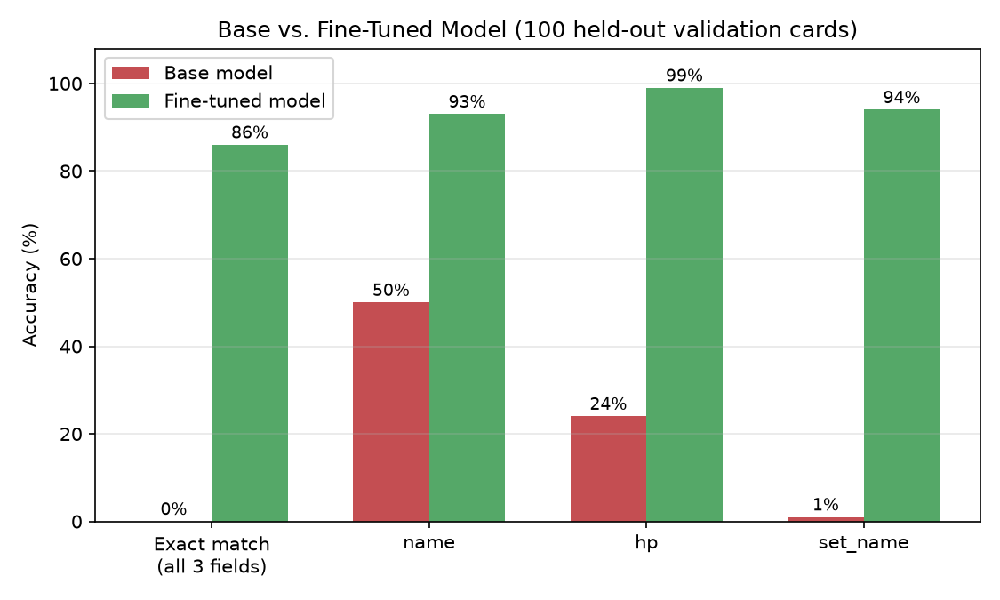
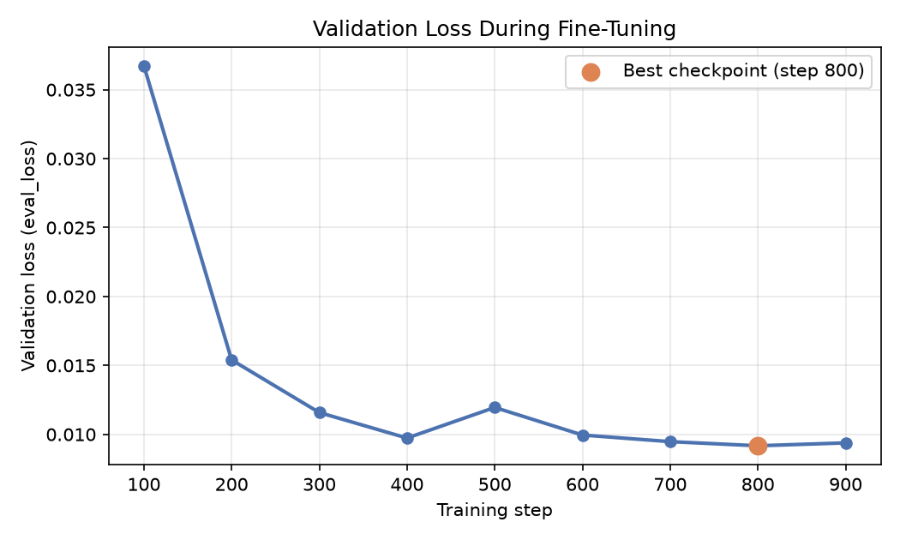
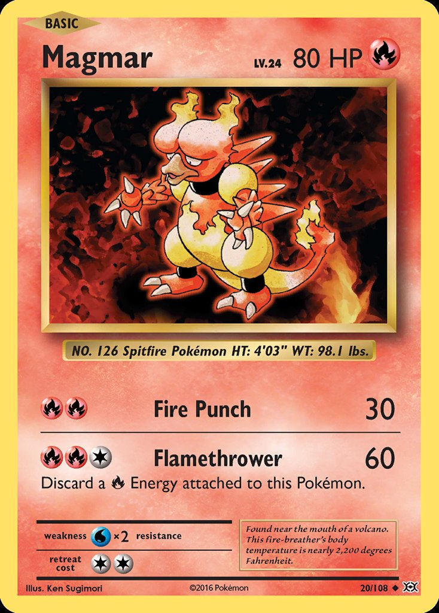
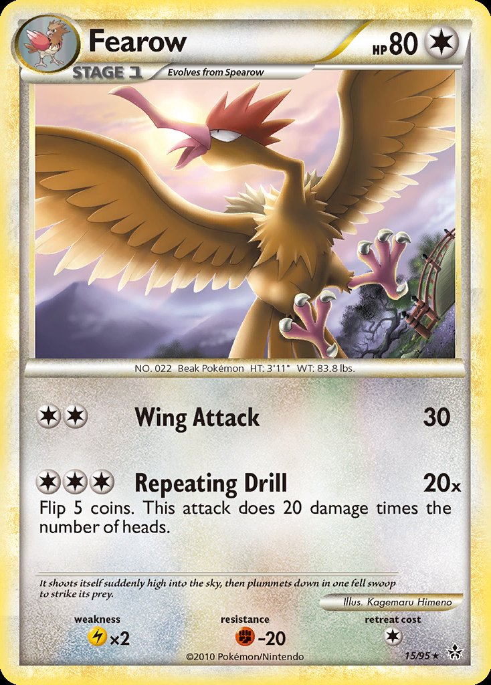
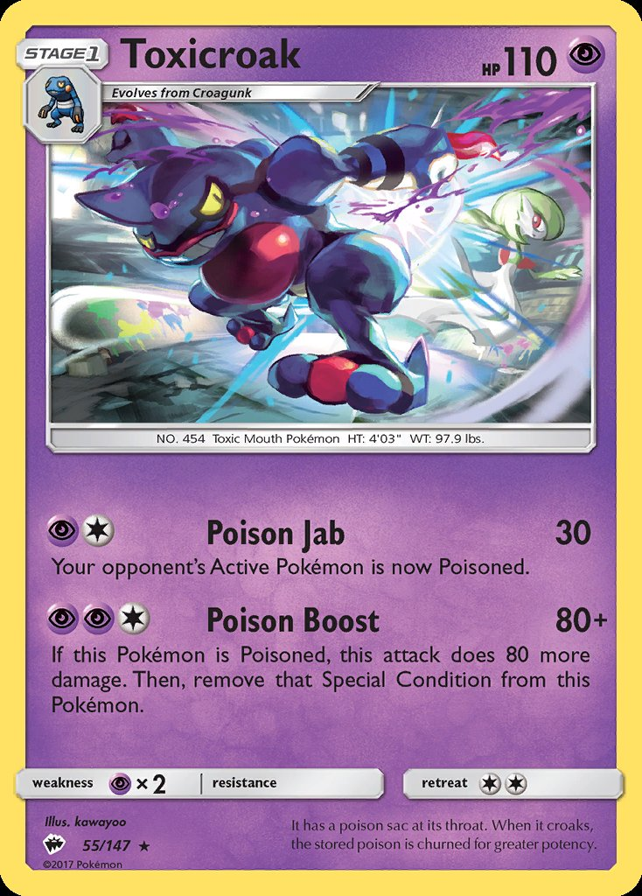
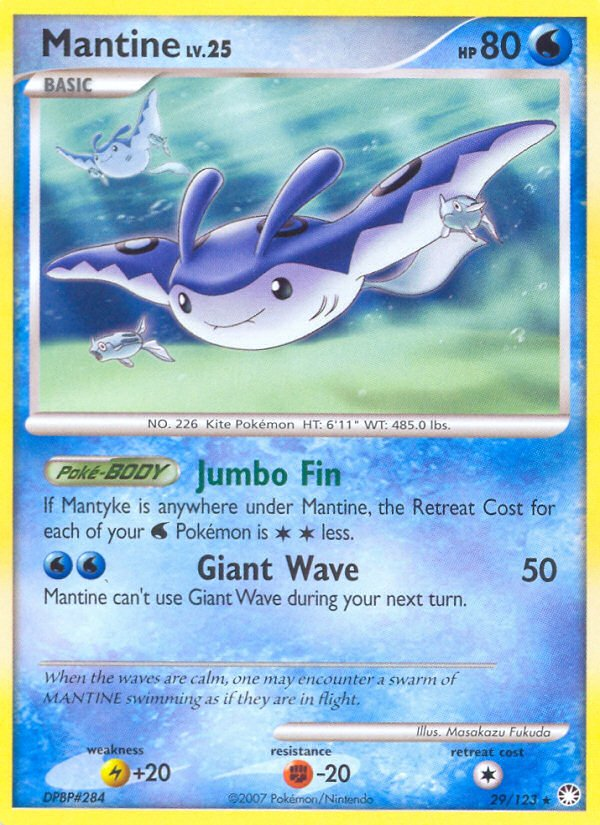
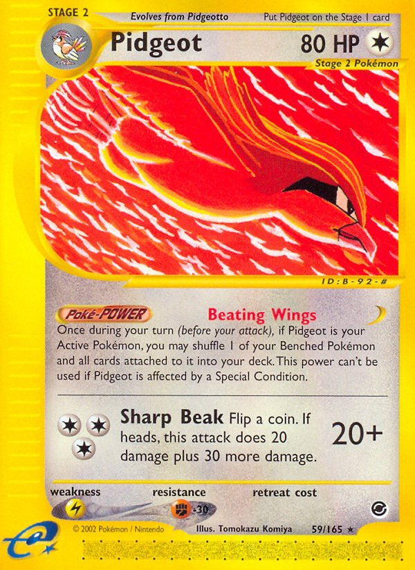
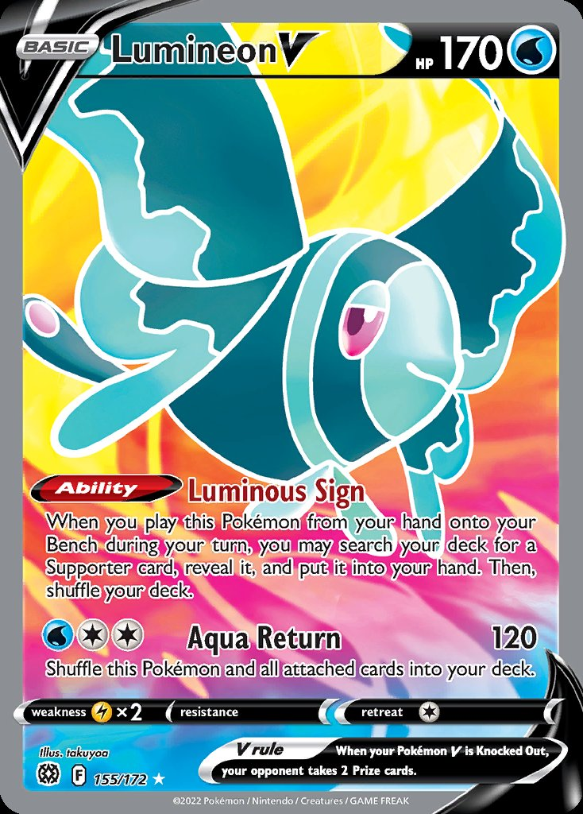

# Pokemon Card Pokedex — fine-tuning SmolVLM2

Tried fine-tuning a small vision-language model to read Pokemon TCG cards and spit out structured JSON (name, HP, set) — basically building my own AI-powered Pokedex. Turned out pretty well.

**Model:** [`atharvasawant99/smolvlm2-pokemon-cards-v1`](https://huggingface.co/atharvasawant99/smolvlm2-pokemon-cards-v1) on Hugging Face
**Base model:** [`HuggingFaceTB/SmolVLM2-500M-Video-Instruct`](https://huggingface.co/HuggingFaceTB/SmolVLM2-500M-Video-Instruct)
**Dataset:** [`TheFusion21/PokemonCards`](https://huggingface.co/datasets/TheFusion21/PokemonCards) (1,500 sampled cards, 85/15 train/val split)
**Original notebook (prototyped on Kaggle, 2x T4):** [kaggle.com/code/atharvasawant69/vlm-finetuning-notebook](https://www.kaggle.com/code/atharvasawant69/vlm-finetuning-notebook)
**Actual training run:** Modal, 1x NVIDIA H100 (80GB)

---

## Before vs. after

Gave the model a card image and this prompt:

> This is a Pokemon TCG card. Reply with ONLY a raw JSON object: `{"name": ..., "hp": ..., "set_name": ...}`

Base model mostly guesses or rambles. Fine-tuned model nails the structured output almost every time.

<table>
<tr>
<td width="50%">
Base vs. fine-tuned accuracy
</td>
<td width="50%">
Validation loss during training
</td>
</tr>
</table>

| | Exact match (all 3 fields) | `name` | `hp` | `set_name` | JSON parse failures |
|---|---|---|---|---|---|
| **Base model** | 0% | 50% | 24% | 1% | 1/100 |
| **Fine-tuned model** | **86%** | 93% | 99% | 94% | 0/100 |

*(measured on 100 held-out validation cards the model never trained on)*

Loss drops fast in the first ~400 steps, wobbles a bit, then the best checkpoint lands at **step 800** (`eval_loss = 0.00917`) — training kept going to step 900 but validation loss ticked back up slightly there, so step 800 is what actually got saved and pushed (thanks to `load_best_model_at_end`).

## Sample cards

Six real cards from the held-out validation set (the model never saw these during training). Base model output is often close but rambly, malformed, or just wrong; fine-tuned output is clean structured JSON, correct almost every time — including one genuine miss below (card 3), shown as-is rather than cherry-picked away.

<table>
<tr>
<th>Card</th><th>Ground truth</th><th>Base model</th><th>Fine-tuned model</th>
</tr>
<tr>
<td></td>
<td><code>{"name": "Magmar", "hp": "80", "set_name": "Evolutions"}</code></td>
<td>❌ <code>{"name": "Magmar", "hp": "80 HP digits only", "set_name": "Pokémon"}</code></td>
<td>✅ <code>{"name": "Magmar", "hp": "80", "set_name": "Evolutions"}</code></td>
</tr>
<tr>
<td></td>
<td><code>{"name": "Fearow", "hp": "80", "set_name": "HS—Unleashed"}</code></td>
<td>❌ <code>{"name": "Fearow", "hp": "83.8", "set_name": "Stage 1 Evolves from Spearow"}</code></td>
<td>✅ <code>{"name": "Fearow", "hp": "80", "set_name": "HS—Unleashed"}</code></td>
</tr>
<tr>
<td></td>
<td><code>{"name": "Toxicroak", "hp": "110", "set_name": "Burning Shadows"}</code></td>
<td>❌ <code>{"name": "Evolves from Croquunk", "hp": "HP digits only", "set_name": "HP digits only"}</code></td>
<td>⚠️ <code>{"name": "Toxiccroak", "hp": "110", "set_name": "Crimson Invasion"}</code> — HP right, name/set wrong</td>
</tr>
<tr>
<td></td>
<td><code>{"name": "Mantine", "hp": "80", "set_name": "Mysterious Treasures"}</code></td>
<td>❌ <code>{"name": "Mantine", "hp": "HP digits only", "set_name": "the set name"}</code></td>
<td>✅ <code>{"name": "Mantine", "hp": "80", "set_name": "Mysterious Treasures"}</code></td>
</tr>
<tr>
<td></td>
<td><code>{"name": "Pidgeot", "hp": "80", "set_name": "Expedition Base Set"}</code></td>
<td>❌ <code>{"name": "Pidgeot", "hp": "80 HP digits only", "set_name": "Pidgeot on the Stage I card"}</code></td>
<td>✅ <code>{"name": "Pidgeot", "hp": "80", "set_name": "Expedition Base Set"}</code></td>
</tr>
<tr>
<td></td>
<td><code>{"name": "Lumineon V", "hp": "170", "set_name": "Brilliant Stars"}</code></td>
<td>❌ <code>1700</code> — not even valid JSON</td>
<td>✅ <code>{"name": "Lumineon V", "hp": "170", "set_name": "Brilliant Stars"}</code></td>
</tr>
</table>

---

## How it was actually trained

- **Vision encoder frozen**, only the language model half was trained (~421M of 507M total params trainable).
- **Native bf16** on H100 — no autocast/mixed-precision (avoids a known SmolVLM `inputs_merger` dtype crash under Trainer's own mixed-precision path). The original Kaggle prototype used fp16 for the same reason, since T4 doesn't have real bf16 support.
- **900 steps**, effective batch size 16 (batch size 1 × 16 gradient accumulation steps), `learning_rate=2e-4`, constant schedule.
- A collator sanity-check runs before training starts — it verifies the label masking isn't accidentally zeroing out every trainable token (this silently broke an earlier run and produced `loss=0.0`/`nan` for hours before anyone noticed).
- Checkpointed every 100 steps, best-by-`eval_loss` kept and pushed to Hugging Face.
- Training took ~75 minutes end-to-end on the H100.

## Hardware

| | Prototype (Kaggle) | Final training run |
|---|---|---|
| GPU | 2x T4 (pinned to 1) | 1x H100 (80GB) |
| Platform | Kaggle Notebooks | [Modal](https://modal.com) |
| Precision | native fp16 | native bf16 |

## Files in this project

| File | What it does |
|---|---|
| `modal_train.py` | The actual training script that produced this model (Modal + H100) |
| `train.py` | Same training logic, adapted for Baseten Training (A10G) |
| `config.py` | Baseten training job config |
| `generate_showcase.py` | Pulls real held-out cards + runs base vs. fine-tuned inference for this README |
| `requirements.txt` | Python dependencies |
