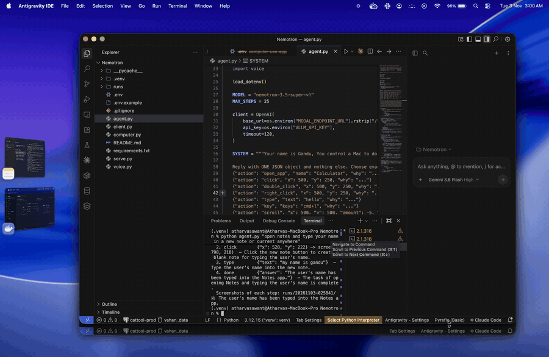

# Nemotron Computer-Use Agent

A small voice + vision agent that controls your Mac. It looks at the screen, decides one action, does it, and repeats until the task is done.

The model is **NVIDIA Nemotron 3.5 Super VL**, self-hosted on [Modal](https://modal.com) with vLLM. Speech-to-text and the voice run on your Mac.



<sub>[Full-quality video (MP4)](docs/demo.mp4)</sub>

## How it works

```
screenshot ──► Nemotron on Modal ──► one action (click / type / key / scroll / open app) ──► do it ──► repeat
```

| File | Job |
|---|---|
| `serve.py` | Modal app: runs `vllm serve` on 4×H100 |
| `agent.py` | The loop: screenshot → model → action, until "done" |
| `computer.py` | Screenshots, mouse and keyboard |
| `voice.py` | Whisper speech-to-text (on your Mac) and the macOS voice |
| `client.py` | Quick test request to the server |

## Setup

**1. Server (once)**
```bash
uv venv && source .venv/bin/activate && uv pip install -r requirements.txt
modal token new
cp .env.example .env          # fill in HF_TOKEN and VLLM_API_KEY
modal secret create nemotron-secrets --from-dotenv .env --force
modal run serve.py::download  # weights (~240GB) to a Modal Volume
modal deploy serve.py         # put the printed URL in .env as MODAL_ENDPOINT_URL
```

**2. Mac permissions:** System Settings → Privacy & Security. Turn on your terminal app under **Screen Recording**, **Accessibility** and **Microphone**, then restart the terminal.

## Use

```bash
python agent.py "open Calculator and compute 19 times 37"
python agent.py "what is on my screen?"      # screenshot understanding only
python agent.py --voice                      # Enter to talk, Enter to stop
python agent.py --dry-run "open Safari"      # show the first action, do nothing
```

Each run saves what the model saw, with its click marked, to `runs/<time>/step-NN.jpg`.

**Stop:** Ctrl+C, or push the mouse into a screen corner.

## Good to know

- **Cold start:** Modal turns the GPUs off after 15 idle minutes, and waking them takes about 8 minutes. The agent waits for it on its own.
- **Cost:** 4×H100 bills while the server is up. Run `modal app stop nemotron-vl` to stop it now.
- **Coordinates:** the model answers on a 0–1000 scale, and `computer.py` converts that to screen points.
- **Clipboard:** typing works by pasting, so it overwrites your clipboard.
